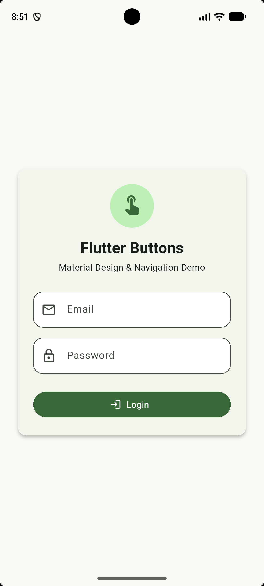
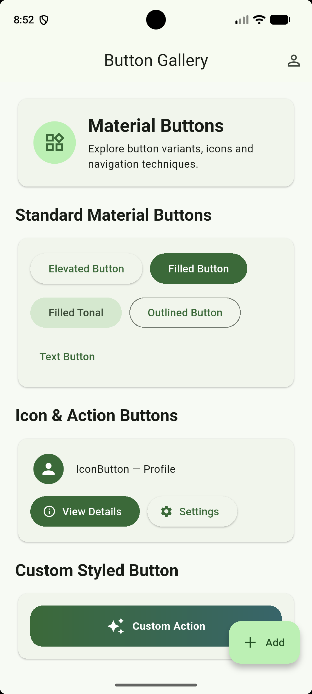
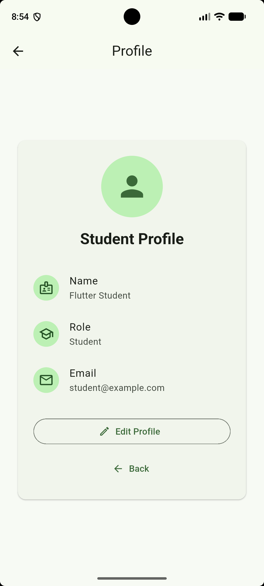
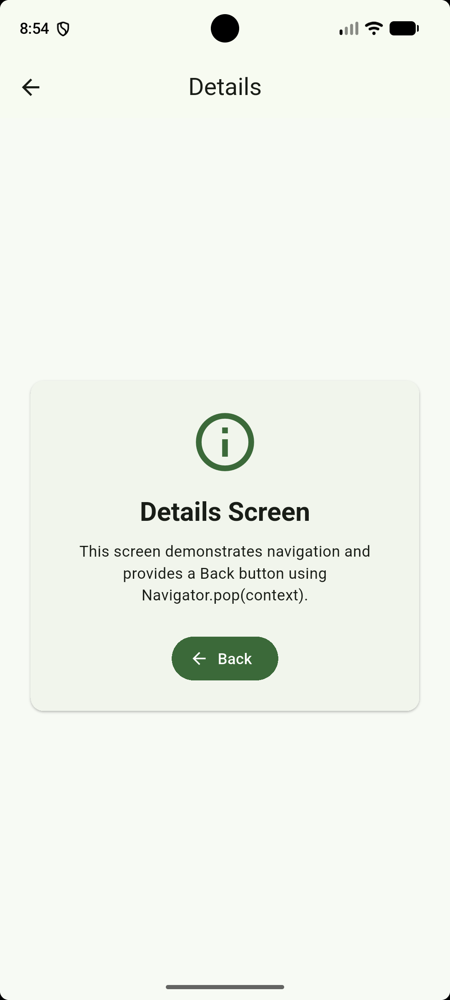
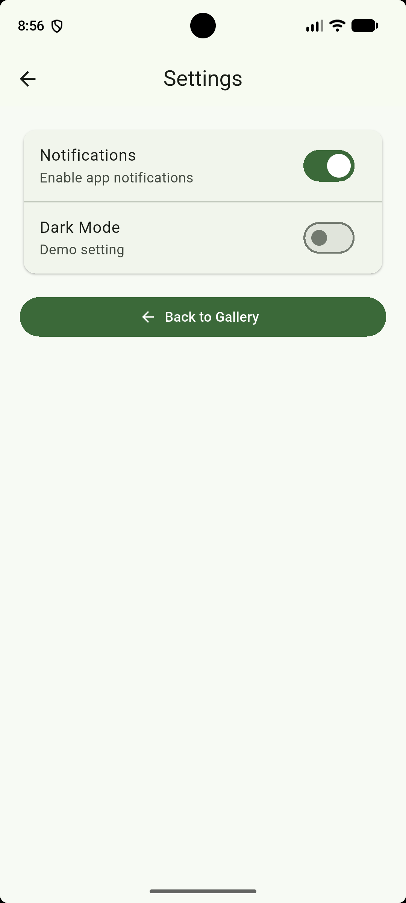

# Flutter Buttons & Navigation

A practical Flutter application demonstrating Material Design button variants and multiple navigation techniques.

## Assignment Requirements Covered

- MaterialApp and Scaffold
- AppBar and SafeArea
- ElevatedButton
- FilledButton
- FilledButton.tonal
- OutlinedButton
- TextButton
- IconButton
- FloatingActionButton
- Buttons with icons
- Custom-styled button
- Multiple screens
- Navigator.push()
- Navigator.pop()
- Navigator.pushReplacement()
- Named routes with `routes` and `Navigator.pushNamed()`
- Responsive mobile-friendly layout

## Screens

1. Login
2. Button Gallery
3. Details
4. Profile
5. Settings
6. Add Item

## Navigation Demonstration

### Navigator.push()
The Elevated Button opens a Details preview with:

```dart
Navigator.push(
  context,
  MaterialPageRoute(
    builder: (_) => const _DetailsPreview(),
  ),
);
```

### Navigator.pop()
The Back buttons return to the previous screen:

```dart
Navigator.pop(context);
```

### pushReplacement()
Login replaces itself with Button Gallery:

```dart
Navigator.pushReplacementNamed(context, '/buttons');
```

Logout replaces Button Gallery with Login:

```dart
Navigator.pushReplacementNamed(context, '/');
```

### Named Routes
Routes are declared in `MaterialApp`:

```dart
routes: {
  '/': (context) => const LoginScreen(),
  '/buttons': (context) => const ButtonGalleryScreen(),
  '/profile': (context) => const ProfileScreen(),
  '/details': (context) => const DetailsScreen(),
  '/settings': (context) => const SettingsScreen(),
  '/add': (context) => const AddScreen(),
},
```

Navigation example:

```dart
Navigator.pushNamed(context, '/profile');
```

## How to Run

1. Install Flutter and Android Studio/VS Code.
2. Open this project folder.
3. Run:

```bash
flutter pub get
flutter run
```

If this folder was copied into a fresh Flutter project, use:

```bash
flutter create .
flutter pub get
flutter run
```

## Suggested GitHub Submission Steps

```bash
git init
git add .
git commit -m "Create Flutter buttons gallery and navigation"
git branch -M main
git remote add origin https://github.com/YOUR-USERNAME/flutter-buttons-navigation.git
git push -u origin main
```

## Screenshots

After running the application, take screenshots of:
- Login screen
- Button Gallery
- Profile screen
- Details screen
- Settings screen

Save them inside the `screenshots/` folder and add them to this README.

Example:

```markdown
## Screenshots

### Login


### Button Gallery


### Profile


### Details


### Settings

```

## Meaningful Commit Messages

Recommended commits:
- `Create Flutter project structure`
- `Add login and button gallery`
- `Add navigation screens`
- `Implement named routes and pushReplacement`
- `Improve responsive UI`
- `Add application screenshots and README`

